# 🍄💡 Bioluminescent-Fungus Enzymes: Do Colder-Habitat Species Have Cold-Adapted Sequences?

-00457c)  

**Author:** Riddhika D

## Background
Plants can be made to **glow** by adding the four-gene **fungal bioluminescence pathway** — HispS → H3H → Luz → CPH (Mitiouchkina et al. 2020; Shakhova et al. 2024). A real open question for autonomous glowing plants is whether the light dims on **cold nights**, since enzymes slow in the cold.

## Question
Across real bioluminescent fungi, do the pathway enzymes from **cooler-climate** species already carry the sequence features that mark **cold-adapted (psychrophilic)** enzymes? If so, those species' genes would be the first to try for cold-night glow.

## Method (fixed before looking at results)
- **Data:** every real **Luz, H3H, HispS, CPH** protein in UniProt from fungi, downloaded live in the notebook. No sequence is typed in.
- **Cold-adaptation markers (pre-registered, from Siddiqui & Cavicchioli 2006; Metpally & Reddy 2009):** more **Gly**, fewer **Pro**, fewer large hydrophobics (I+V+L+F+W+Y), fewer charged R+E, lower **Arg/(Arg+Lys)**. Combined into one z-scored *cold score* per family.
- **Positive control:** known psychrophile proteins (*Colwellia*) vs thermophile proteins (*Thermus*), fetched live. They **must** separate on the markers, or the method is not trusted.
- **Test:** within each enzyme family, do cooler-climate fungi score higher than warm-climate ones (one-sided Mann–Whitney)?

## Result: inconclusive (and the notebook says so)
Ran live on **32 real proteins across 11 fungal species** (11 Luz, 14 H3H, 1 HispS, 6 CPH).

**The positive control FAILED**, so by the pre-registered rule nothing below it is trusted:

| | Gly | Pro | Arg/(Arg+Lys) |
|---|---|---|---|
| psychrophile (cold) | 0.076 | 0.039 | 0.391 |
| thermophile (hot) | 0.086 | 0.062 | 0.609 |

The cold organism should show **more** glycine than the hot one; it showed less. The marker set, applied to a small, function-unmatched set of proteins, could not reproduce textbook cold-vs-hot biology, so it is not reliable for the fungal comparison.

A nominal Luz result (cooler-climate proteins scored higher, p = 0.016 one-sided) is **not trustworthy**, for two reasons:
1. the positive control failed, and
2. **climate is confounded with taxonomy** here — the "temperate" group is *Armillaria / Mycena / Panellus* and the "warm" group is *Neonothopanus / Omphalotus / Guyanagaster*, so any difference likely reflects genus ancestry, not temperature.

**Honest verdict: no trustworthy signal. Inconclusive.** This repository is kept as a transparent, reproducible negative/inconclusive result, including a positive-control check that correctly caught the method's weakness.

## Honest limits
- **Habitat temperature is only roughly known**, and is confounded with genus in this small sample.
- **Sequence markers are a hypothesis generator, not proof of cold activity.** Nothing here measures enzyme kinetics.
- The cold/hot amino-acid signal is a whole-proteome average; a handful of proteins is too few to see it reliably.

## Correction notice
The earlier version of this project ("Project 2 — Autonomous Bioluminescent Plant", stages 1–21) has been removed because it was not real analysis:
- The protein **sequences were mislabelled** — the "luciferase" sequence was actually an HSP70 heat-shock protein, and the "CPH hydrolase" was a short-chain dehydrogenase.
- Kinetics, ΔG, "genome-scale FBA", "ray tracing", Monte-Carlo and **"wet-lab assay" numbers were all typed in or randomly generated, not computed from data.**

This version uses only real UniProt sequences and only values that are computed from them.

## Run it
Open `bioluminescent_cold_adaptation.ipynb` in Google Colab → **Runtime → Run all** (2–5 min). Copy the result box at the end.

## Files
| File | Purpose |
|---|---|
| `bioluminescent_cold_adaptation.ipynb` | Full analysis |
| `bioluminescent_cold_adaptation_RUN.ipynb` | Same notebook with outputs |
| `biolum_cold_markers.csv` | Per-protein marker table |
| `biolum_cold_scores.png` | Cold-score plot by family and climate |

## References
- Mitiouchkina T et al. (2020) Plants with genetically encoded autoluminescence. *Nature Biotechnology* 38:944–946.
- Shakhova ES et al. (2024) Improved fungal bioluminescence pathway. *Nature Methods*.
- Siddiqui KS, Cavicchioli R (2006) Cold-adapted enzymes. *Annu Rev Biochem* 75:403–433.
- Metpally RPR, Reddy BVB (2009) Comparative proteome analysis of psychrophilic vs mesophilic organisms. *BMC Genomics* 10:11.
- Protein data: UniProt (https://www.uniprot.org).
